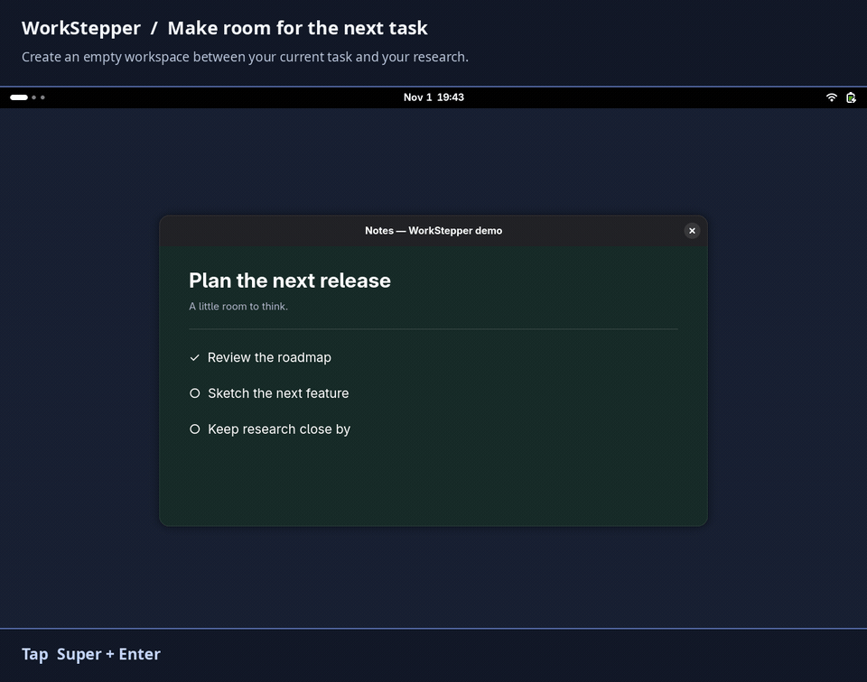
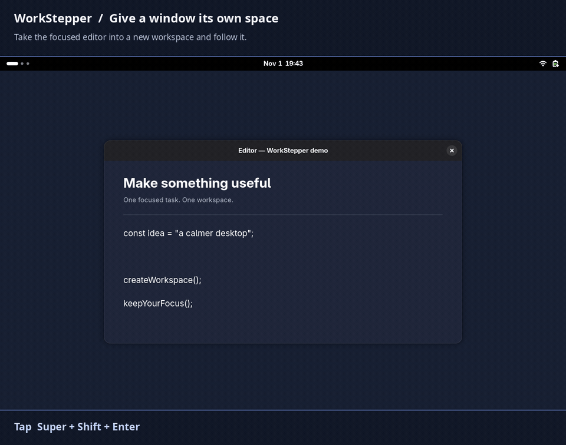
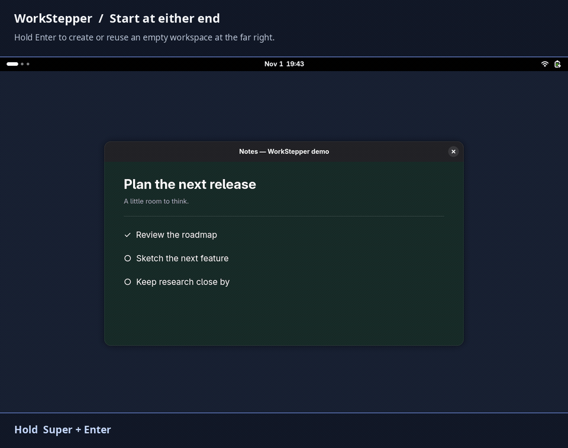

# WorkStepper

WorkStepper lets you make room for a new task without rearranging your existing windows. Create an empty workspace beside your current one, take a window into its own workspace, or start a new workspace at either end of the workspace list—all from the keyboard.

It supports **GNOME Shell 51**, with dynamic or fixed workspaces.

## See it in action

**Make room for a new task.** Tap **Super + Enter** to create an empty workspace on the right and switch to it. Here, Overview opens on arrival.



**Give a window its own space.** Add **Shift** to carry the focused window with you, leaving the other windows in place.



**Start at either end.** Hold **Super + Enter** for the far right or **Super + Backspace** for the far left. An empty end workspace is reused; an occupied end gets a new workspace beyond it.



## How it works

A workspace action creates an empty workspace in the chosen position and switches to it. If that position already has an empty workspace, WorkStepper reuses it. Occupied workspaces keep their windows.

For example, if Mail is active and Browser is on the workspace immediately to its right, **Super+Enter** inserts an empty workspace between them and takes you there. If the right-hand workspace is already empty, you simply switch to it.

Add **Shift** to bring the focused window with you. This is useful for pulling one window out of a crowded workspace and giving it its own space.

## Default shortcuts

| Shortcut | Tap | Hold |
| --- | --- | --- |
| Super + Backspace | Create/reuse on the left and switch | Create/reuse at the far left |
| Super + Enter | Create/reuse on the right and switch | Create/reuse at the far right |
| Super + Shift + Backspace | Create/reuse on the left, move the window, and follow | Do the same at the far left |
| Super + Shift + Enter | Create/reuse on the right, move the window, and follow | Do the same at the far right |
| Super + Delete | Remove the workspace, keeping its windows | Close its windows, then remove the workspace |

**Holding still creates or reuses an empty workspace.** At the chosen end, an empty first/last workspace is reused; an occupied one gets a new workspace before/after it. GNOME’s trailing empty workspace is therefore reused when dynamic workspaces are enabled.

Taps run on key release. Holds run once, after **175 ms** by default; you can adjust this from **75 to 2000 ms**.

Removing a workspace keeps its windows on a neighboring workspace. Holding Delete requests normal window closes and respects unsaved-work prompts. Windows on other workspaces stay open, and GNOME always keeps at least one workspace.

## Preferences

Click a shortcut row to record a new combination or disable it. A reset button appears beside a customized shortcut; **Reset All** restores every setting.

The **window-moving modifier** adds Shift, Ctrl, or Alt to your workspace shortcuts to derive the window-moving shortcuts. Choose **None** to edit those shortcuts independently; otherwise their rows are dimmed.

Choose **Overview**, **App Grid**, or **None** separately for:

- Creating or reusing a workspace.
- Creating or reusing a workspace while carrying a window.
- Other switches to an empty workspace, such as GNOME’s regular workspace navigation.

These opening choices apply when switching from the desktop. Navigation within Overview or App Grid preserves the current view. Overview focuses search so you can immediately type an app name.

Minimized windows count as occupying a workspace; pinned windows do not. GNOME’s normal dynamic-workspace cleanup still applies to empty inactive workspaces.

## Install

Requires GNOME Shell 51, Node.js, GJS, `glib-compile-schemas`, and `gnome-extensions`.

```sh
git clone https://github.com/drkhn1234/WorkStepper.git
cd WorkStepper
npm run pack
gnome-extensions install --force dist/workspace-step@drkhn.shell-extension.zip
gnome-extensions enable workspace-step@drkhn
```

If GNOME cannot find the newly installed extension, log out and back in, then enable it. Open preferences with:

```sh
gnome-extensions prefs workspace-step@drkhn
```

## Development

Run `npm test` for automated tests. `npm run test:shell` runs isolated GNOME Shell tests and also requires Python 3, PyGObject, GTK 4, and libadwaita.

Licensed under [GPL-3.0-or-later](LICENSE).
